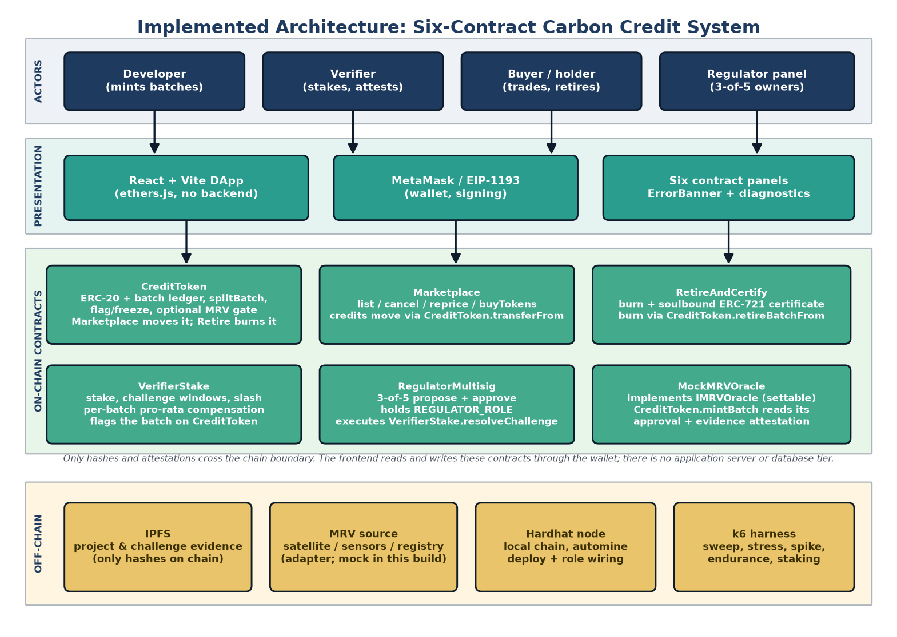

# Digital Assignment 3 (DA3) Report
## Blockchain-Based Carbon Credit Trading with Verifier Accountability

**Course:** Blockchain Technology · **Assessment:** Digital Assignment 3
**Submitted by:** Avi Dhandhania (25BCE1207), Shivesh Kumar (25BCE1067)
**SDG:** SDG 13, Climate Action

---

## 1. Introduction

### 1.1 Overall

Carbon markets are built on a simple trade: a project that removes or avoids one tonne of carbon dioxide receives a credit, and a company that emits more than its allowance buys that credit. The mechanism only works if the credit represents a tonne that actually exists and if the same tonne cannot be sold twice. In practice, neither condition is guaranteed. Registries are separate databases, verification is slow and manual, project evidence is held off-chain as documents that a buyer cannot check, and a verifier who approves a project that later turns out to be fictitious faces no on-chain consequence. The result is a market in which the record can be internally consistent and still describe projects that never happened.

DA1 studied this problem and proposed a public-Ethereum design in which credits are tokenised, retirement is an irreversible burn, and verifiers stake collateral that can be slashed. DA2 implemented the four core contracts and a React front end. DA3 closes the remaining design gaps and evaluates the result. The implementation now contains six contracts: `CreditToken` (ERC-20 with per-batch provenance), `Marketplace` (listings and purchases), `RetireAndCertify` (burn plus soulbound certificate), `VerifierStake` (stakes, challenge windows, slashing and per-batch compensation pools), `RegulatorMultisig` (a 3-of-5 panel that holds the regulator role), and `MockMRVOracle` behind an `IMRVOracle` interface. A wallet-only React application exposes every operation, and a k6 experiment suite measures the system under controlled concurrent load.

The contribution of DA3 is therefore not a new token standard. It is the composition of existing primitives into a lifecycle that is enforced by code, combined with an economic mechanism for the one step that code cannot verify by itself: whether the physical project exists. The report documents that composition, the algorithms behind it, and the measured behaviour of the resulting system.

### 1.2 Objectives

The objectives of DA3 were defined as the unresolved items of the DA2 roadmap and are restated here in measurable form.

**O1. Remove single-key regulator power.** Replace the externally owned account that resolved challenges in DA2 with a threshold panel, so that no single key can slash a verifier or wave a fraudulent batch through.

**O2. Make the challenge period configurable.** Replace the hard-coded 90-day window with a global default and a per-batch override bounded to one year, so that projects with different risk profiles can be treated differently.

**O3. Provide an MRV attestation path.** Define an oracle interface for measurement, reporting and verification data and make minting optionally require an approved project and a matching evidence hash, without breaking the original permissionless-mint behaviour when no oracle is configured.

**O4. Support fractionalisation without dilution.** Allow part of a batch to be split into a child batch that inherits the parent's verifier and evidence, without minting or burning tokens.

**O5. Compensate the holders of a fraudulent batch pro rata.** Replace the single compensation-recipient address with a per-batch pool that holders claim from in proportion to their holdings, and freeze a flagged batch so that the claimant set cannot be inflated after resolution.

**O6. Verify and measure the system.** Provide a test suite, an end-to-end check through the front-end ABIs, a browser-level check of the real application, and a controlled load experiment that reports capacity, latency and gas rather than asserting scalability.

### 1.3 Summary

All six objectives were implemented and verified in the repository. The unit suite contains 115 passing tests, the end-to-end check makes 25 assertions against a live chain through the front-end ABIs, and the browser check makes 13 assertions against the real application in headless Chrome. The load experiment comprises 44 runs: six workload levels from 10 to 1000 concurrent users with three repetitions each, three baseline arms, four staking scenarios, and stress, spike and endurance shapes.

The measured picture is deliberately modest. On a single-process Hardhat node, successful throughput peaks at 185.2 requests per second with 10 concurrent users and falls below 95 % of that peak by 50 users; the system keeps a success rate above 99 % up to 250 users, and p95 latency first exceeds one second at 100 users. Raw request throughput at 1000 users is not a capacity figure, because 97.8 % of those requests were rejected. The staking layer adds a bounded cost: a challenge costs roughly 220–240 k gas to open and about 626 k gas across the four transactions of a 3-of-5 resolution, while a retirement costs about 1.48 M gas on average and up to 2.37 M for a holder with the 400-batch experiment pool, because the token re-sums the holder's batch list. Those numbers describe a correct prototype on a development chain, not a production capacity claim.

The report is organised as follows. Section 2 reviews related work and states, for each line of work, the limitation that this implementation addresses. Section 3 describes the methodology, the architecture, every module in detail, the core algorithms and the evaluation method. Section 4 reports and discusses the results and compares them with the related work. Section 5 lists the references.

---

## 2. Related Work

Carbon-credit tokenisation was studied as a market-design problem before it was studied as a systems problem. Swinkels (2024) analysed a carbon token exchange and showed that tokenisation can improve liquidity and price discovery, while warning that the quality of the underlying credits is not established by the token itself [11]. Zhang (2024) surveyed blockchain applications in carbon trading and grouped them into issuance, trading and tracking functions, but the surveyed systems generally treated the three functions as separate services rather than as one enforced lifecycle [12]. However, neither line of work made retirement the only terminal state of a credit or tied the verifier's identity and evidence hash to the token. This work implements the lifecycle as one contract set: a batch carries its verifier and evidence hash, retirement burns the balance and mints a non-transferable certificate in the same transaction, and a retired batch cannot be listed or split again.

The economics of emissions trading are well developed. Ellerman, Marcantonini and Zaklan (2016) reviewed a decade of the European Union Emissions Trading System and documented how cap design, allowance allocation and price signals changed abatement behaviour [14]. The World Bank (2024) reported the continuing growth of carbon pricing instruments and, in the same document, the persistent integrity problems of voluntary markets [13]. However, both analyses took the correctness of the underlying registry as given and focused on prices and allowances. This work treats registry correctness as the variable under design: the ledger records not only the quantity of a credit but the evidence and the accountable party behind it, and the challenge mechanism gives that record a way to be reversed.

The infrastructure used here is standard. Nakamoto (2008) introduced the peer-to-peer ledger and proof-of-work consensus that made an append-only public record practical [1], and Buterin (2014) generalised the ledger into a programmable state machine [2]. Vogelsteller and Buterin (2015) defined the ERC-20 fungible-token interface [3], and Entriken et al. (2018) defined ERC-721 for non-fungible tokens [4]. However, these specifications are general-purpose: they define balances and transfers, not what a token means or who is accountable for it. This work composes both standards with carbon-specific semantics — ERC-20 for fungible tonnes within a batch, ERC-721 with transfers disabled for a retirement certificate, and role-based access control for the four market actors.

Soulbound credentials were proposed by Weyl, Ohlhaver and Buterin (2022) as non-transferable tokens that encode commitments and affiliations [5]. However, the discussion was primarily about identity and social provenance, and it did not address a market in which a retirement claim must be both public and impossible to reuse. This work applies the soulbound property to a narrower and more testable object: a retirement certificate that names the retiring address, the batch, the number of tonnes and the time, and that cannot be transferred, approved or sold. The certificate makes a retirement claim attributable; the burn makes it final.

Verification incentives have a separate literature. Luu, Teutsch, Kulkarni and Saxena (2015) described the verifier's dilemma: when checking work is costly and unverifiable, rational participants skip it, and the consensus computer degrades [6]. However, the proposed remedies operated inside a consensus protocol and did not carry over to a physical-world attestation, where the "work" is a site visit or a satellite analysis. This work applies the same logic to MRV: a verifier must lock at least one ether before attesting, the stake stays exposed through the challenge window, and a successful challenge returns part of the slashed stake to the challenger, which pays for the checking work that the verifier's dilemma predicts will otherwise be skipped.

Challenge periods and fraud proofs were popularised by layer-2 systems. Kalodner et al. (2018) described Arbitrum's optimistic execution, in which a claim is accepted unless someone disputes it within a window and the dispute is adjudicated by a defined procedure [7]. However, the disputed statement there was a computation that could be re-executed deterministically, whereas a carbon project cannot be re-executed; its truth depends on physical evidence. This work keeps the optimistic structure — attest now, challenge within a window, resolve later — but replaces deterministic re-execution with a regulator panel that judges evidence, and makes the window configurable per batch rather than fixed by protocol.

Proof-of-stake finality supplied the slashing primitive. Buterin and Griffith (2017) described Casper, in which validators deposit stake and lose part of it for provably faulty behaviour [8]. However, slashing there punishes protocol faults such as double signing, not false data. This work uses the same primitive for data faults: a verifier whose batch is successfully challenged loses half of its remaining stake, the batch is flagged and transfer-frozen, and the buyers' half of the penalty is held in a per-batch pool that they claim pro rata.

Oracles are the standard answer to the boundary between a chain and the physical world. Ellis, Juels and Nazarov (2017) described a decentralised oracle network that aggregates external data and delivers it on-chain [9]. However, an oracle network improves the reliability of a feed; it does not, by itself, make a particular attestation costly to falsify for a particular batch. This work defines a minimal `IMRVOracle` interface (`isProjectApproved`, `getProjectHash`, `getVerifiedTonnage`) and lets `CreditToken` require it at mint time. The provided `MockMRVOracle` is admin-settable, so the implementation proves the plumbing and the optionality of the gate, not the provenance of the data; the economic penalty remains with the staked verifier.

Smart-contract security is a prerequisite for any of the above. Atzei, Bartoletti and Cimoli (2017) catalogued reentrancy, access-control and arithmetic attacks and showed how often they appear in deployed contracts [10]. However, a taxonomy does not by itself demonstrate that a carbon-specific design avoids the relevant classes. This work applies the mitigations directly — OpenZeppelin `AccessControl` for roles, `ReentrancyGuard` on every value-moving function, checks-effects-interactions ordering, and a flag that freezes transfers rather than relying on front-end warnings — and reports the tests that exercise the resulting permission and boundary behaviour.

Remote sensing is the most credible source of independent MRV evidence. Harris et al. (2021) produced global maps of twenty-first-century forest loss at 30 m resolution, which is exactly the kind of evidence a challenger could anchor by hash [15]. However, such maps end at the boundary of the scientific product; they do not settle a market dispute or move money. This work supplies the settlement side: a challenge carries an evidence hash, the resolution is executed by a 3-of-5 panel, and the financial consequences are automatic.

Finally, the sustainability of the infrastructure itself matters for a climate application. Christidis and Devetsikiotis (2016) argued that smart contracts can coordinate IoT devices and transactions at low cost [18]; Andoni et al. (2019) reviewed blockchain in the energy sector and identified scalability and governance as the main obstacles [16]; Sedlmeir et al. (2020) separated the energy cost of consensus from the energy cost of the application and showed that the former dominates [17]. However, these studies measured general-purpose platforms, not a carbon-market workload. This work measures the workload it actually implements and is explicit that a single local node with automine is a latency floor, not a public-network prediction; the deployment path in the design is a Layer 2 network, where the consensus cost is shared rather than paid per credit.

Across these lines of work the same gap recurs: the token, the market, the oracle and the verifier were each studied in isolation, and the economic penalty for a false attestation was either absent or confined to a protocol. This work contributes the integration: one contract set in which evidence is bound to a batch, a verifier's money is at risk through a configurable window, a multi-signature panel resolves disputes, retirement is a burn with a soulbound certificate, and the whole path is exercised by tests and measured under load.

---

## 3. Methodology

### 3.1 Research design

The work followed a design-science cycle rather than a purely exploratory study. The problem and requirements came from DA1; the first design and a partial implementation came from DA2; DA3 iterated on the gaps that DA2 documented and then evaluated the result. Each iteration had the same four steps:

1. **Specify the invariant.** For example, "sum of batch supplies equals total supply", "a flagged batch cannot be transferred", or "a challenge can only be resolved once".
2. **Implement the smallest change that enforces it**, preferring OpenZeppelin primitives over new cryptographic code.
3. **Test the invariant and its boundaries** in the Hardhat suite, including the negative cases that a happy-path demonstration would miss.
4. **Exercise the path through the real interfaces** — the front-end ABIs for end-to-end behaviour, the real application in a browser, and the k6 harness for concurrency.

The toolchain was Solidity 0.8.20 with OpenZeppelin Contracts 5.0.2, Hardhat 2.19 for compilation, testing and deployment, ethers v6 in both the scripts and the front end, React 18 with Vite, and Grafana k6 v2.2.0 for load generation. Statistics and figures were generated from the raw k6 exports by Node and Python scripts, so that every number in the results section can be traced to a run file rather than typed into the report.

### 3.2 Architecture

Figure 1 shows the implemented architecture. It differs from the DA1 design in one deliberate way: there is no application server and no off-chain database. The React application talks to the contracts through the user's wallet, so the only trusted components are the contracts and the wallet. This removes a cache that could disagree with the chain and removes an API that would have to be secured, at the cost of making every read an RPC call.



The system has four layers.

**Actors.** A developer mints batches after a project is approved. A verifier stakes collateral and attests the project; the attestation is the mint transaction itself. A buyer purchases credits, may split a batch, and retires credits to obtain a certificate. A regulator panel of five owners, any three of whom can resolve a challenge, holds the regulator role. The same wallet can hold more than one role, but the contracts check the role on every call rather than inferring it from the user interface.

**Presentation.** The React application has one panel per contract plus a wallet-connection component. Each panel reads state through `eth_call` and writes through the wallet. A shared `ErrorBanner` and a diagnostics module surface RPC failures instead of leaving a rejected transaction silent. The application never holds a private key: MetaMask (or any EIP-1193 provider) signs, and the panel passes the transaction to it.

**On-chain contracts.** `CreditToken` is the shared ledger and the only contract that knows what a batch is. `Marketplace` moves credits between accounts. `RetireAndCertify` burns them and mints the certificate. `VerifierStake` holds deposits, opens and resolves challenges, and holds the per-batch compensation pools. `RegulatorMultisig` is the only address with `REGULATOR_ROLE` on `VerifierStake` after deployment, and it forwards a resolution only after three distinct owners approve it. `MockMRVOracle` implements the oracle interface and is read by `CreditToken.mintBatch` when an oracle is configured.

**Off-chain components.** Project documents and challenge evidence live in IPFS; only their hashes are stored on-chain. A production MRV feed would sit behind an adapter that implements `IMRVOracle`; the supplied mock is set by an administrator and exists to test the gate. The Hardhat node provides the development chain, the deployment script wires the roles, and the k6 harness drives the deployed contracts over JSON-RPC.

The important architectural property is the direction of trust. The chain does not trust the front end: every permission is checked in a contract. The chain does not trust the oracle blindly: the oracle can block a mint, but the verifier's stake is what makes a false attestation expensive. The chain does not trust a single regulator: the multisig is the only regulator, and its threshold is fixed at construction.

### 3.3 Module descriptions

#### 3.3.1 CreditToken

`CreditToken` is an ERC-20 (`CC`) with a per-batch ledger. Its purpose is to make a credit traceable to a project, a verifier and an evidence hash while remaining fungible within that batch.

The state consists of a `Batch` struct (`batchId`, `projectId`, `verifier`, `ipfsHash`, `amount`, `timestamp`, `isRetired`, `isFlagged`), a `batchBalances[batchId][account]` mapping, a `userBatches[account]` list, a `batchParent[child]` link, and `batchSupply[batchId]`. Two bookkeeping structures make batch maintenance constant-time: `_batchIndex[account][batchId]` stores the 1-based position of a batch inside the holder's list, and `activeBatchCount[account]` stores how many batches the holder is in. The invariant is that the sum of all `batchSupply` values equals `totalSupply()`; this is what lets the compensation mechanism divide a pool across the holders of one batch without iterating over all accounts.

`mintBatch(projectId, ipfsHash, amount)` requires `MINTER_ROLE`, a positive amount, a non-empty project identifier and a non-empty evidence hash. When an MRV oracle is configured, it additionally requires `isProjectApproved(projectId)` and `getProjectHash(projectId) == keccak256(bytes(ipfsHash))`. The second check binds the on-chain hash to the hash the oracle attested, so a minter cannot present different evidence to the oracle and to the ledger. With no oracle set, the function behaves exactly as it did before the oracle existed, which keeps the DA2 deployment and tests valid.

`_update(from, to, value)` is the hook that keeps batch accounting consistent on every transfer. For a normal transfer it walks the sender's batch list starting at the oldest batch, moves the required amount batch by batch, and calls `_addBatchToUser` and `_removeBatchFromUser` as balances appear and disappear. Both helpers are constant-time because the index map records where each batch sits; the recipient is never scanned, and a batch that reaches zero is swapped with the last entry and popped. `_update` also reverts if the batch being debited is flagged. That freeze is a deliberate design decision: after a successful challenge the compensation denominator is a snapshot of the batch supply, and allowing the batch to keep trading would let new holders enter after the snapshot and dilute the buyers who were actually exposed. The freeze is lifted only by an explicit administrator call, which makes the exception auditable.

`transferBatchFrom(from, to, batchId, amount)` is the batch-faithful settlement path, restricted to `BATCH_TRANSFER_ROLE`, which the marketplace holds. It checks the named batch's balance and flag state, consumes the owner's allowance, moves the ERC-20 balance through `super._update` so the oldest-first hook is bypassed, and debits and credits the named batch's ledger directly. The role therefore grants the ability to name a batch, not the ability to spend without consent: a seller must still approve the marketplace.

The inherited permissionless `burn` and `burnFrom` are disabled: they revert with `Use retireBatch` and `Use retireBatchFrom`. A burn that bypassed `_retireBatch` would leave `batchSupply` and the holder's batch list inconsistent, and retirement is the only terminal state the design allows.

`retireBatch` and `retireBatchFrom` burn credits from a specific batch. The second is used by `RetireAndCertify`: it consumes the caller's allowance and then calls the internal `_retireBatch`, which checks the batch balance, rejects a retired or flagged batch, burns the tokens, updates `batchSupply`, and marks the batch retired when the supply reaches zero. When the holder's balance of that batch reaches zero the batch is dropped through the index map, so the cost is constant and does not depend on how many batches the account has ever held. A regression test covers the terminal flag, because an earlier version read `isRetired` but never set it, which made a dead batch indistinguishable from a live one.

`splitBatch(batchId, amount, projectId)` is the fractionalisation primitive. It moves `amount` from the parent batch into a new child batch, records the parent link, and copies the parent's verifier and IPFS hash. No tokens are minted or burned: total supply and the sum of batch supplies are unchanged. A flagged or fully retired parent cannot be split, which prevents a disputed batch from being laundered into a clean-looking child. `flagBatch` is restricted to the default administrator and is the only way to freeze or unfreeze a batch.

#### 3.3.2 Marketplace

`Marketplace` is a listing book. A seller with `BUYER_ROLE` calls `createListing(batchId, amount, pricePerToken)`, which checks that the seller actually holds that amount of that batch, that the batch is not flagged, and that the price is positive. A listing records the batch, seller, remaining amount, price, active flag and creation time.

`buyTokens(listingId, amount)` checks that the listing is active and has enough remaining, and that the batch is not flagged. It computes `totalPrice = amount * pricePerToken / 1e18`, requires at least that much ether, decrements the listing, settles the credits from the seller to the buyer with `CreditToken.transferBatchFrom(listing.batchId, ...)`, refunds any excess, pays the seller, and deactivates the listing when it reaches zero. The function is `nonReentrant` and follows checks-effects-interactions, so the seller is paid only after the listing and the token balances have been updated.

The module also supports `cancelListing` and `updateListingPrice`, both restricted to the seller, and `getActiveListings`, which returns the ids of all active listings. The implementation is intentionally escrow-free: credits stay in the seller's wallet until a purchase, which avoids a second custody layer but means the seller must keep the approval in place. That trade-off is visible in the load results, where a seller's single allowance is shared across all of its listings.

Settlement names the listed batch because of a defect found while diagnosing the load harness. The first implementation used an ordinary ERC-20 `transferFrom`, and `CreditToken._update` debits the seller's oldest batches first, so a listing for batch X could deliver an older batch Y when the seller held several batches; the buyer then could not retire the project the listing advertised. `transferBatchFrom` moves exactly the listed batch, and a regression test mints two batches to one seller, lists the newer one and asserts that the buyer receives that batch and none of the older one. The marketplace role is paired with the seller's allowance, so the fix does not quietly turn the marketplace into a custodian.

#### 3.3.3 RetireAndCertify

`RetireAndCertify` is an ERC-721 with URI storage and access control. Its purpose is to turn a retirement into a public, non-reusable claim. The contract stores a `Certificate` for each retirement (`certificateId`, `owner`, `batchId`, `amountRetired`, `projectId`, `retirementTimestamp`, `metadataURI`), a per-user certificate list, and `batchTotalRetired`.

`retireAndCertify(batchId, amount, metadataURI)` requires `RETIRE_ROLE`, a positive amount, a non-empty URI, sufficient batch balance for the caller and a batch that is not flagged. It then calls `CreditToken.retireBatchFrom`, which burns the credits and consumes the allowance, reads the project id from the batch, stores the certificate, mints the NFT to the caller, sets its token URI, and emits both `CertificateMinted` and `BatchRetiredViaCertify`. Because the burn and the certificate are in one transaction, the proof of retirement cannot exist without the retirement.

The soulbound property is enforced in `_update`: a transfer is allowed when either side is the zero address (minting or burning) and rejected otherwise. `approve` and `setApprovalForAll` revert unconditionally. The certificate therefore cannot be sold, transferred or used as collateral, which closes the "same retirement sold twice" path that a normal NFT would open.

#### 3.3.4 VerifierStake

`VerifierStake` is the economic core. A verifier with `VERIFIER_ROLE` calls `depositStake` with at least one ether. The deposit is recorded in a `VerifierInfo` struct with the last top-up time and an active flag. `withdrawStake` allows a partial withdrawal only if the remaining stake is at least the minimum (or the withdrawal is the whole stake) and only if the verifier has no active challenges, so a verifier cannot exit while a dispute is open.

`createChallenge(batchId, evidenceHash)` requires `CHALLENGER_ROLE`, a bond of at least 0.1 ether, a non-empty evidence hash, an existing batch, and a timestamp inside the batch's challenge window. The window is resolved by `getChallengeWindow(batchId)`, which returns the per-batch override if one is set and the global `defaultChallengeWindow` otherwise. Both are bounded to 1–365 days, and the default remains 90 days, so a deployment that never calls the setter behaves exactly as DA2 did. The challenge increments a per-verifier active count, which is what blocks stake withdrawal.

`resolveChallenge(challengeId, challengerWins)` requires `REGULATOR_ROLE`. If the challenger wins, half of the verifier's remaining stake is slashed. Half of that goes to the challenger together with the returned bond; the other half is credited to the batch's compensation pool. The batch supply is snapshotted as the denominator, the batch is flagged, and the verifier is deactivated if the remaining stake falls below the minimum. If the challenger loses, the bond is sent to the compensation-pool address and the verifier keeps its stake. A challenge can be resolved only once.

`claimCompensation(batchId)` is the pro-rata claim. It divides the pool by the denominator snapshot and multiplies by the claimant's holdings, caps the result at the remaining pool, and records how many tokens the claimant has already claimed against. That record is what makes a second claim measure only newly acquired tokens and prevents the pool from being over-drawn. The verifier whose batch was flagged is explicitly blocked from claiming from the pool that exists to compensate the buyers it misled.

The module's state also includes the per-batch window overrides, the batch compensation total and remaining pool, and the claimed-token mapping. Its events (`StakeDeposited`, `ChallengeCreated`, `ChallengeResolved`, `CompensationPoolDeposited`, `CompensationClaimed`) form the audit trail used by the front end.

#### 3.3.5 RegulatorMultisig

`RegulatorMultisig` is a minimal threshold gate. Its constructor takes the owner list, the threshold and the `VerifierStake` address; it rejects an empty list, a zero or excessive threshold, duplicate owners and the zero address. Owners can be added or removed after deployment, but a removal that would leave fewer owners than the threshold is rejected, so the panel cannot be reduced to a size that cannot act.

A resolution is opened with `proposeResolution(challengeId, challengerWins)`. Exactly one proposal can exist per challenge id, and the outcome flag is fixed at proposal time, so approvals cannot be collected for one outcome and executed for another. `approveResolution` records one approval per owner and executes automatically when the count reaches the threshold. `executeResolution` is an explicit path for a proposal that already has enough approvals. Execution calls `VerifierStake.resolveChallenge`; the multisig, not the proposer, is the caller, which is why the multisig must hold `REGULATOR_ROLE`.

The deployment script grants `REGULATOR_ROLE` on `VerifierStake` to the multisig and then revokes the deployer's own regulator role unless the operator explicitly asks to keep it. The default therefore satisfies O1: after deployment no single key can resolve a challenge. The escape hatch (`KEEP_DEPLOYER_REGULATOR=true`) exists for demonstrations and is documented as a deliberate weakening, not a default.

#### 3.3.6 MockMRVOracle and IMRVOracle

`IMRVOracle` is a three-function interface: `isProjectApproved(projectId)`, `getProjectHash(projectId)` and `getVerifiedTonnage(projectId)`. `MockMRVOracle` implements it with administrator-settable values and two attestation entry points, one taking a `bytes32` hash and one hashing a string. It exists so that the mint gate can be tested without an external dependency. Its honest limitation is stated in the code and in this report: the mock proves the plumbing, not the data. A production adapter would read satellite imagery, soil sensors or a registry API and would have its own availability and trust assumptions.

#### 3.3.7 Front end and deployment

The React application has a wallet component and one panel per contract. Each panel reads the state it needs on mount and after every transaction, surfaces errors through a shared banner, and disables actions the connected account is not authorised to perform where the role is known. The application deliberately has no backend: ethers v6 is used directly, the addresses and ABIs live in one module, and the wallet is the only signer.

The deployment script deploys the six contracts in dependency order, grants the minter, buyer, retire, verifier and challenger roles, deploys the multisig with five owners and a threshold of three, points `VerifierStake` at the multisig and revokes the deployer's regulator role. It optionally deploys and wires the MRV oracle and writes the addresses into the front-end configuration, which is what makes the end-to-end check run against the same addresses the UI uses.

### 3.4 Algorithms

The four algorithms below are the parts where the invariants are easiest to get wrong. They are written at the level of the Solidity functions rather than as abstract pseudocode, because the order of the checks and the state updates is the point.

**Algorithm 1 — Mint a batch with an optional MRV gate.**

```text
function mintBatch(projectId, ipfsHash, amount):
    require caller has MINTER_ROLE
    require amount > 0 and projectId != "" and ipfsHash != ""
    if mrvOracle != address(0):
        require mrvOracle.isProjectApproved(projectId)
        require mrvOracle.getProjectHash(projectId) == keccak256(ipfsHash)
    batchId <- nextBatchId()
    batch     <- {batchId, projectId, msg.sender, ipfsHash,
                  amount, block.timestamp, false, false}
    _mint(msg.sender, amount)
    batchBalances[batchId][msg.sender] <- amount
    batchSupply[batchId]                <- amount
    _addBatchToUser(msg.sender, batchId)
    emit BatchMinted(...)
    return batchId
```

**Algorithm 2 — Batch-aware transfer and the flag freeze.**

```text
function _update(from, to, value):
    super._update(from, to, value)              // ERC-20 balance move
    if from == 0 or to == 0 or from == to: return
    remaining <- value
    i <- 0
    while remaining > 0:
        require i < userBatches[from].length    // accounting invariant
        batchId <- userBatches[from][i]
        balance <- batchBalances[batchId][from]
        require balance > 0                     // stale entry fails, never loops
        require not batches[batchId].isFlagged  // frozen after a challenge
        move <- min(balance, remaining)
        batchBalances[batchId][from] -= move
        _addBatchToUser(to, batchId)            // O(1), no-op if already listed
        batchBalances[batchId][to] += move
        remaining -= move
        if batchBalances[batchId][from] == 0:
            _removeBatchFromUser(from, batchId) // swap-and-pop via _batchIndex
        else:
            i += 1

function transferBatchFrom(from, to, batchId, amount):   // marketplace only
    require caller has BATCH_TRANSFER_ROLE
    require allowance(from, caller) >= amount
    require batchBalances[batchId][from] >= amount and not flagged
    _approve(from, caller, allowance - amount)
    super._update(from, to, amount)             // skip the oldest-first walk
    batchBalances[batchId][from] -= amount
    _addBatchToUser(to, batchId)
    batchBalances[batchId][to] += amount
    if batchBalances[batchId][from] == 0:
        _removeBatchFromUser(from, batchId)
```

**Algorithm 3 — Retirement and fractionalisation.**

```text
function _retireBatch(owner, batchId, amount):
    require batchBalances[batchId][owner] >= amount
    require not batches[batchId].isRetired
    require not batches[batchId].isFlagged
    _burn(owner, amount)
    batchBalances[batchId][owner] -= amount
    batchSupply[batchId]          -= amount
    if batchSupply[batchId] == 0:
        batches[batchId].isRetired <- true      // terminal state
    if batchBalances[batchId][owner] == 0:
        _removeBatchFromUser(owner, batchId)    // O(1); no re-sum of the list
    emit BatchRetired(batchId, amount)

function splitBatch(batchId, amount, projectId):
    require batch exists and not flagged and not retired
    require amount > 0 and projectId != ""
    require batchBalances[batchId][msg.sender] >= amount
    batchBalances[batchId][msg.sender] -= amount
    batchSupply[batchId]              -= amount
    childId <- nextBatchId()
    child   <- {childId, projectId, parent.verifier, parent.ipfsHash,
                amount, now, false, false}
    batchParent[childId]  <- batchId
    batchSupply[childId]  <- amount
    batchBalances[childId][msg.sender] <- amount
    emit BatchSplit(batchId, childId, msg.sender, amount)   // no mint, no burn
```

**Algorithm 4 — Challenge resolution and pro-rata compensation.**

```text
function resolveChallenge(challengeId, challengerWins):
    require caller has REGULATOR_ROLE
    require not challenge.isResolved
    challenge.isResolved <- true
    verifier <- CreditToken.getBatchVerifier(challenge.batchId)
    if challengerWins:
        slashed <- verifierStake[verifier] / 2
        reward  <- slashed / 2
        verifierStake[verifier] -= slashed
        if verifierStake[verifier] < MIN_STAKE:
            verifier.isActive <- false
        transfer challenge.bond + reward to challenger
        pool[challenge.batchId]        += slashed - reward
        poolTotal[challenge.batchId]   += slashed - reward
        denominator[challenge.batchId]  <- CreditToken.getBatchSupply(batchId)
        CreditToken.flagBatch(batchId, true)     // transfer-frozen
    else:
        transfer challenge.bond to compensationPool
    decrement activeChallengeCount[verifier]

function claimCompensation(batchId):
    require poolTotal[batchId] > 0 and denominator[batchId] > 0
    require caller != CreditToken.getBatchVerifier(batchId)
    balance  <- CreditToken.getUserBatchBalance(batchId, caller)
    claimed  <- compensationClaimedTokens[batchId][caller]
    require balance > claimed
    share <- poolTotal[batchId] * (balance - claimed) / denominator[batchId]
    share <- min(share, pool[batchId])            // never over-draw
    compensationClaimedTokens[batchId][caller] <- balance
    pool[batchId] -= share
    transfer share to caller
```

**Algorithm 5 — 3-of-5 resolution.**

```text
function proposeResolution(challengeId, challengerWins):
    require caller is owner
    require no proposal exists for challengeId
    proposals[challengeId] <- {challengeId, challengerWins, 0, false, true}

function approveResolution(challengeId):
    require caller is owner
    require proposal exists and not executed
    require caller has not already approved
    approved[challengeId][caller] <- true
    proposal.approvals += 1
    if proposal.approvals >= threshold:
        execute(challengeId)

function execute(challengeId):
    require proposal.approvals >= threshold
    proposal.executed <- true
    VerifierStake.resolveChallenge(challengeId, proposal.challengerWins)
```

The algorithms make the trust boundaries explicit. Algorithm 1 is the only place where off-chain data enters a mint, and it is optional. Algorithm 2 is the only place where a transfer can be blocked, and it blocks the whole batch rather than one account. Algorithm 3 preserves the supply invariant under both burn and split. Algorithm 4 is the only place where money moves because of a dispute, and it cannot run twice for the same challenge. Algorithm 5 is the only path to Algorithm 4 after deployment.

### 3.5 Evaluation method

Evaluation used four layers, each answering a different question.

**Unit and integration tests (115).** The Hardhat suite covers the core contracts (50 tests) and the DA3 features (65 tests): multisig threshold behaviour and duplicate approvals, per-batch window bounds and override resolution, oracle gating and hash matching, split invariants and parent lineage, flag-freeze behaviour, pro-rata claims including repeat claims and verifier exclusion, and the regression for the retired-batch flag. The suite runs against a fresh chain per test file and asserts revert reasons as well as state.

**End-to-end check (25 assertions).** `frontend/scripts/verify-integration.mjs` reuses the front-end ABI module against a freshly deployed chain and exercises the full path: mint, approve, list, buy, retire, certificate ownership, challenge creation, multisig proposal and approvals, resolution, compensation claim, and split. It exists to catch the case where a contract is correct but the ABI or address wiring used by the UI is not.

**Browser check (13 assertions).** `frontend/scripts/browser-check.mjs` loads the real Vite application in headless Chrome with an injected EIP-1193 provider, connects through the application's own connect path, and asserts what the DOM renders: every panel is present, total supply is bound to chain state, the multisig panel shows its threshold and owners, and the console is free of errors. It does not test MetaMask's popup or network-switch UX, which remains a manual step.

**Load experiment (44 runs).** The k6 suite has three fixed-size arms (baseline, staking off, staked), six workload levels (10, 50, 100, 250, 500, 1000 concurrent virtual users) with three repetitions and 60 s warm-up, 180 s measurement and 30 s cool-down, four staking scenarios, a stress ladder (10→1000), a spike (50→500→50) and a 30-minute endurance run at 100 users. Every request carries an operation and phase tag, so latency and throughput are computed inside the measurement window and per operation. The reported capacity figure is **successful** throughput, not raw request throughput, because a rejected request is still a request and would otherwise make a failing node look fast. Gas is read from transaction receipts. Because the actor mix is assigned per virtual user, the retire role lands on users 21 and 42 of every hundred, so the 10-user level contains no retirement actor and retirement is exercised from 21 users upward; the 2 % retire share therefore describes the mix at the larger levels, not at every level.

The statistical treatment is descriptive. Each level reports mean, median, standard deviation, variance, min, max, p90, p95 and p99 across repetitions, plus a normal-approximation 95 % confidence interval for the mean. With three repetitions the interval describes where the mean plausibly sits; it is not a significance test. Two different percentiles are kept separate: the within-run p95 is what a user experiences in one run, while the across-run p95 is how much the per-run aggregate moves between repetitions.

The threats to validity are stated with the results rather than after them. The chain is a single-process Hardhat node with automine, so there is no network hop and no mempool; the JSON-RPC read path is a single JavaScript thread and is the measured bottleneck. The load generator and the chain share one host, so they contend for CPU and memory. The users are scripted, not real organisations. The baseline contract is a deliberately minimal registry written for the comparison, not a deployed alternative system. The retirement path in the 44-run dataset predates a harness fix --- the suite sent `retireAndCertify` with a gas limit below its real cost, so every attempt was rejected before mining --- and is therefore reported from a verification run through the fixed harness rather than from the sweep; Section 4.5 explains exactly what changed.

---

## 4. Results and Discussion

### 4.1 Functional results

All verification layers passed. The unit suite reports 115 passing tests and no failures. The end-to-end script reports 25 passed assertions against a fresh local deployment, covering the complete lifecycle including a successful challenge, a 3-of-5 resolution and a compensation claim. The browser check reports 13 passed assertions in headless Chrome, including the multisig panel's threshold and owner list and the absence of console errors. The production build of the front end completes without errors.

Two defects were found by these layers rather than by the happy-path demonstration. The first was a stale-closure bug in four panels: their initial `loadData()` call captured a contract instance that was still undefined, so the first render showed empty panels until the user acted. The browser check caught it because it asserted the rendered total supply rather than the presence of a button. The second was the missing `isRetired` assignment in `_retireBatch`, which made a fully retired batch report itself as live forever; the unit suite now covers it.

During the DA3 load work two further defects were found and fixed, both in the settlement path. The first was that a purchase did not necessarily deliver the batch named by the listing: `buyTokens` used an ordinary ERC-20 transfer and the token debits the seller's oldest batches first, so the listing could deliver a different project. The second was that retirement cost grew with the number of batches a holder had ever owned, because `_retireBatch` re-summed the holder's batch list to decide whether to clear it. Neither failed the original functional tests, because those tests use a seller that holds a single batch, and the second only appeared once the experiment pool gave a holder 400 batches. Both now have regression tests: a two-batch seller whose listing delivers the listed batch, and a gas assertion that a 30-batch holder retires within 30 k gas of a one-batch holder.

### 4.2 Gas and mechanism cost

Table 1 reports gas measured from receipts in the experiment suite. The retirement row comes from the verification run through the fixed harness described in Section 4.5, because the 44-run dataset predates that fix.

| Operation | Mean gas | Notes |
|---|---:|---|
| `mintBatch` (1000 credits, no oracle) | 256,721 | constant for the batch size used |
| `buyTokens` (1 credit) | 92,835 | includes the ERC-20 transfer and seller payment |
| `approve` (ERC-20) | 26,275 | first approval to a spender |
| `depositStake` (1 ETH) | 39,686 | one-time per verifier |
| `createChallenge` (0.1 ETH bond) | 227,898 | includes the window check and active-count update |
| `proposeResolution` (multisig) | 92,279 | one proposal per challenge |
| `approveResolution` (multisig) | 101,884 | each approval; the third executes |
| Resolution total (3-of-5) | 625,828 | proposal + three approvals, excluding the challenge |
| `retireAndCertify` (0.25 credit) | 1,483,347 avg (342,491–2,370,578) | grows with the holder's batch count |

*Table 1. Measured gas per operation. Sources: `loadtest/results/exp/` for the first eight rows; the 19-transaction verification run through the fixed harness for the last row.*

The retirement number is the most important and the least flattering. `CreditToken._retireBatch` re-sums the holder's entire batch list to decide whether to clear it, so the cost grows with the number of batches that account has ever held. With the experiment pool of 400 batches, the same call estimated at 2,348,600 gas and mined for up to 2,370,578; with a small holder it costs about 342,000. This is a real scalability defect of the accounting design, not a measurement artefact: a long-lived verifier or developer accumulates batches and eventually exceeds the gas limit of a normal transaction. The fix is to maintain a running per-holder total instead of re-summing, which is a contract change and is left as future work. For DA3 it is enough to state the growth and to note that the load harness initially hid it by sending a 2 M gas limit, which the node rejected before mining.

The dispute path is cheap in absolute terms but structurally expensive. A 3-of-5 resolution costs about 626 k gas across four transactions, roughly 2.4 times the cost of opening the challenge. That is the explicit price of removing single-key regulation: the same decision that a single regulator transaction could make now needs a quorum, and the quorum needs a proposal to prevent approvals from crossing between outcomes.

### 4.3 Capacity and latency

Table 2 reports the steady-state measurements on the local chain. All figures are means over three repetitions and are measured inside the 180 s window.

| Concurrent users | Successful throughput (req/s) | p95 latency (ms) | Success rate (%) |
|---:|---:|---:|---:|
| 10 | 185.2 | 63.2 | 100.00 |
| 50 | 114.8 | 848.1 | 100.00 |
| 100 | 104.3 | 1,365.2 | 100.00 |
| 250 | 82.8 | 4,016.3 | 99.93 |
| 500 | 80.4 | 6,546.3 | 95.90 |
| 1000 | 83.9 | not usable | 2.22 |

*Table 2. Successful throughput, p95 latency and success rate by workload level. At 1000 users, 97.8 % of requests were rejected and the latency percentiles describe failed connections, so they are not reported as user latency.*

The capacity curve is a saturation curve, not a scaling curve. Throughput peaks at the lowest level tested and falls by 38 % by 50 users; beyond that it is roughly flat while latency grows by two orders of magnitude. The system stays fully successful up to 100 users, retains 99.93 % at 250 and 95.90 % at 500, and collapses at 1000. Raw request throughput at 1000 users was 3,783 req/s, but only 2.2 % of those requests succeeded; the raw number is a failure rate, and it is reported only to be dismissed.

The latency budget tells the same story earlier than the success rate. p95 first exceeds one second at 100 users, a level at which every request still succeeds. That is the useful operating limit for this deployment: the system can absorb 100 users with sub-1.4 s p95 and no errors, and it can absorb 250 users if a four-second tail is acceptable. The 1000-user point is outside the operating envelope, not a demonstration of scale.

The stress, spike and endurance shapes separate the failure modes. The stress ladder reached 14.1 % success with a p95 of 2,031 ms, which is the expected outcome of pushing to 1000 users and crossing the 99 % success threshold. The spike from 50 to 500 users kept 99.99 % success but pushed p95 to 4,459 ms, so the burst was absorbed as queueing rather than errors. The 30-minute endurance run at 100 users held 100 % success and 127.8 successful requests per second with a p95 of 1,331 ms; node memory grew by 585 MB over the run. That growth is an observation, not a leak diagnosis, because a single 30-minute run cannot distinguish a warm cache from a leak.

The comparison arms isolate the cost of the staking layer. Under an identical fixed-iteration workload, the baseline registry averaged 349.95 ms per verification at 100.4 requests per second, the proposed contracts with staking off averaged 206.71 ms at 131.0 requests per second, and the staked verifier averaged 214.49 ms at 150.6 requests per second. All three arms succeeded on every request. The staked arm is not slower than the unstaked one in this workload; the one-time stake deposit is amortised across 200 verifications, and the extra reads are cheap `eth_call`s. The dispute path is the expensive part, and it exists only in the proposed system.

These numbers do not support a scalability claim. The chain is a single node with automine, the read path is one thread, and the generator shares the host. They do support a narrower claim: the implemented workload has a measurable operating envelope, the staking layer adds a bounded cost on the verification path, and the dispute path is expensive but rare. A curve on Sepolia or a Layer 2 network would have a different shape and would need its own run.

### 4.4 Comparison with related work

Table 3 compares this implementation with the main lines of related work on the properties that DA3 set out to add. The comparison is qualitative because the cited systems were evaluated on different chains, workloads and data, and a numerical comparison would be misleading.

| Property | Tokenisation studies (Swinkels, 2024; Zhang, 2024) | Registry / ETS economics (Ellerman et al., 2016; World Bank, 2024) | General token and oracle infrastructure (EIP-20/721; ChainLink, 2017) | This work |
|---|---|---|---|---|
| Credit traceable to project, verifier and evidence | Partly; token metadata varies | No; registry-level | No; generic primitives | Yes: batch stores project, verifier and IPFS hash |
| Lifecycle enforced by code | Usually separate services | No | No | Yes: mint → trade → retire, with terminal burn |
| Verifier economically accountable | No | No | No | Yes: stake, bond, slashing, challenger reward |
| Dispute resolved by a panel | No | Administrative process | No | Yes: 3-of-5 multisig, single-key role revoked |
| Non-reusable retirement proof | Rare | Paper certificate | Generic NFT, transferable unless customised | Soulbound ERC-721, transfers and approvals disabled |
| Fractionalisation without dilution | Sometimes at token level | No | No | `splitBatch`, supply invariant preserved |
| Pro-rata compensation for buyers | No | No | No | Per-batch pool, snapshot denominator, repeat-claim tracking |
| Measured under controlled load | Market data, not system load | No | No | 44 k6 runs, gas from receipts, success-rate budgets |

*Table 3. Qualitative comparison. "Partly" indicates that the property exists in some implementations but is not enforced by the cited study.*

The first row of the table is the one the literature emphasises, and this work is not novel there. What is different is the combination of rows three to eight: the verifier's accountability, the panel, the soulbound certificate, the fractionalisation invariant and the compensation pool are not separate proposals but one lifecycle in which each step constrains the next. The compensation pool is a good example. A pool only makes sense if the batch supply is known and frozen; the freeze only makes sense if a challenge can name a batch; a challenge only makes sense if the batch records its verifier and evidence. The design is a chain of dependencies, and the contribution is that the chain is implemented and tested end to end rather than argued.

The comparison also exposes what this work does not do. It does not improve on Swinkels' market analysis or Zhang's survey of adoption; it does not model allowance allocation or price formation like the ETS literature; it does not provide a decentralised oracle network like ChainLink; and it does not establish the energy cost of a production deployment. It is a systems contribution: a concrete, tested composition with measured behaviour, and a list of the places where that composition still fails.

### 4.5 Discussion and limitations

**The oracle proves plumbing, not data.** `MockMRVOracle` is admin-settable. The mint gate therefore demonstrates that an attestation can be required and that the evidence hash can be bound to the token, but it does not demonstrate that the attested tonnes exist. A production deployment needs an adapter to satellite, sensor or registry sources, and that adapter inherits the trust and availability problems of its source. The verifier stake is the economic backstop for a false attestation, not a substitute for the data.

**Batch fidelity and retirement cost: both defects are closed.** The multi-batch listing defect and the super-linear retirement cost described in Section 4.1 were fixed in the contracts, not worked around in the harness. Settlement now calls `transferBatchFrom`, which moves the batch the listing names; a seller must still approve the marketplace, so the new role does not grant spending power. Retirement now removes a batch through an index map and maintains a per-holder batch count, so it no longer re-sums the holder's list. The measured effect is in Section 4.2.

**Listings are not reserved.** A seller can list the same credits twice, or move them after listing, because the marketplace is escrow-free. The second purchase then reverts atomically on the batch balance check; no buyer funds are lost, but the listing book can advertise more than the seller actually has. Reserving listed amounts, or escrowing the credits in the marketplace, would close this and is the natural next step if the market is used by untrusted sellers.

**The panel is only as good as its owners.** The multisig removes a single key, but the five owners are peers chosen at deployment, not regulated entities with a legal duty. Adding or removing an owner is itself an owner action, and the constructor cannot verify that the initial panel is independent. This is a governance limitation, not a code defect; a production system would need an appointment process and a public owner list.

**The freeze is admin-liftable.** `flagBatch(batchId, false)` restores transferability. The escape hatch is deliberate, because a false challenge should be reversible, but it means the freeze is only as trustworthy as the administrator key. The alternative — an irrevocable freeze — would make a mistaken resolution permanent, which is worse for a market that depends on being able to correct errors.

**The evaluation is local and scripted.** The chain is a single Hardhat node with automine; the users are k6 virtual users, not organisations; the baseline is a load-test artefact; the host is shared between generator and chain; and the retirement figures come from a 19-transaction verification run through the fixed harness rather than from the 44-run dataset, whose retirement counters remain zero by construction. The front-end load is exercised in a browser check with an injected provider, not with real MetaMask. These are stated as boundaries on the claims, not as reasons to discount the measurements.

**The deployment is not public.** No mainnet or testnet deployment is claimed, because that requires funded keys and an irreversible decision. The code and the deployment script are ready for a testnet, and the design path is a Layer 2 network where the consensus cost is shared and gas is cheaper.

### 4.6 Objectives revisited

O1 is met: the regulator role is held by a 3-of-5 multisig and the deployer's single-key role is revoked at deployment. O2 is met: the window is configurable globally and per batch, bounded to 1–365 days, with the 90-day default preserved. O3 is met at the interface level: `IMRVOracle` and the optional mint gate are implemented and tested, with the mock's provenance limitation stated. O4 is met: `splitBatch` moves credits into a child batch without changing total supply, and blocks flagged or retired parents. O5 is met: the per-batch pool, snapshot denominator, repeat-claim accounting and verifier exclusion are implemented and tested, and the transfer freeze closes the late-entry path. O6 is met with the boundaries above: 115 unit tests, 25 end-to-end assertions, 13 browser assertions and a 44-run load experiment are reported with their limitations.

The honest overall conclusion is that the design is implementable and the implementation behaves as designed within a development environment. The two questions that remain open are not code questions. The first is data provenance: an oracle can be wired, but a real MRV feed needs a provider and an adapter. The second is governance: a multisig can remove a single key, but it cannot by itself make a panel independent or legitimate. Both are named here so that the next iteration starts from the real boundary rather than from a claim that the boundary has been crossed.

---

## 5. References

[1] S. Nakamoto, "Bitcoin: A peer-to-peer electronic cash system," 2008. [Online]. Available: https://bitcoin.org/bitcoin.pdf

[2] V. Buterin, "Ethereum white paper: A next-generation smart contract and decentralized application platform," 2014. [Online]. Available: https://ethereum.org/en/whitepaper/

[3] F. Vogelsteller and V. Buterin, "EIP-20: Token standard," Ethereum Improvement Proposals, no. 20, Nov. 2015. [Online]. Available: https://eips.ethereum.org/EIPS/eip-20

[4] W. Entriken, D. Shirley, J. Evans, and N. Sachs, "EIP-721: Non-fungible token standard," Ethereum Improvement Proposals, no. 721, Jan. 2018. [Online]. Available: https://eips.ethereum.org/EIPS/eip-721

[5] E. G. Weyl, P. Ohlhaver, and V. Buterin, "Decentralized society: Finding Web3's soul," SSRN Electronic Journal, May 2022, doi: 10.2139/ssrn.4105763.

[6] L. Luu, J. Teutsch, R. Kulkarni, and P. Saxena, "Demystifying incentives in the consensus computer," in Proc. 22nd ACM SIGSAC Conf. Computer and Communications Security (CCS), Denver, CO, USA, 2015, pp. 706–719.

[7] H. Kalodner, S. Goldfeder, X. Chen, S. M. Weinberg, and E. W. Felten, "Arbitrum: Scalable, private smart contracts," in Proc. 27th USENIX Security Symp., Baltimore, MD, USA, 2018, pp. 1353–1370.

[8] V. Buterin and V. Griffith, "Casper the friendly finality gadget," arXiv:1710.09437, 2017.

[9] S. Ellis, A. Juels, and S. Nazarov, "ChainLink: A decentralized oracle network," 2017. [Online]. Available: https://chain.link/whitepaper

[10] N. Atzei, M. Bartoletti, and T. Cimoli, "A survey of attacks on Ethereum smart contracts (SoK)," in Principles of Security and Trust (POST), Uppsala, Sweden, 2017, pp. 164–186.

[11] L. Swinkels, "Trading carbon credit tokens on the blockchain," International Review of Economics & Finance, vol. 91, pp. 720–733, 2024.

[12] G. Zhang, "Blockchain technology in carbon trading markets," Energies, vol. 17, no. 13, art. 3296, 2024.

[13] World Bank, State and Trends of Carbon Pricing 2024. Washington, DC, USA: World Bank, 2024.

[14] D. Ellerman, C. Marcantonini, and A. Zaklan, "The European Union Emissions Trading System: Ten years and counting," Review of Environmental Economics and Policy, vol. 10, no. 1, pp. 89–107, 2016.

[15] N. L. Harris et al., "Global maps of twenty-first century forest loss," Nature Climate Change, vol. 11, no. 3, pp. 234–240, 2021.

[16] M. Andoni et al., "Blockchain technology in the energy sector: A systematic review of challenges and opportunities," Renewable and Sustainable Energy Reviews, vol. 100, pp. 143–174, 2019.

[17] J. Sedlmeir, H. U. Buhl, G. Fridgen, and R. Keller, "The energy consumption of blockchain technology: Beyond myth," Business & Information Systems Engineering, vol. 62, no. 6, pp. 599–608, 2020.

[18] K. Christidis and M. Devetsikiotis, "Blockchains and smart contracts for the Internet of Things," IEEE Access, vol. 4, pp. 2292–2303, 2016.
